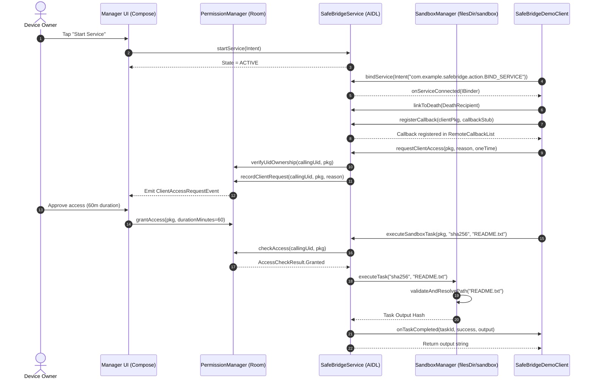
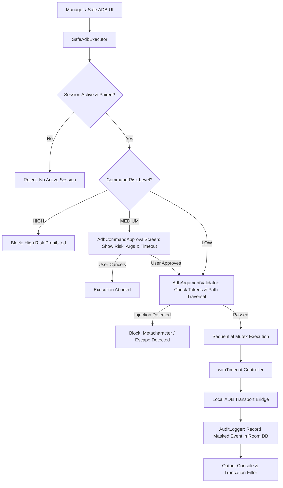

# SafeBridge Architecture & Operating Guide

## 1. System Architecture & Component Interaction



## 2. Safe ADB Execution Flow



## 3. How to Run and Test

### A. Running Automated JVM Tests (Robolectric & JUnit)
Execute all unit and security regression tests from the terminal:
```bash
gradle :app:testDebugUnitTest
```
The test suite validates:
1. Granting and revoking client permissions.
2. Expiration of temporary authorizations.
3. Single-use exhaustion for one-time permissions.
4. Prevention of UID spoofing attempts.
5. Rejection of canonical path traversal attempts (`../etc/passwd`, `/data/...`).
6. Execution of allowlisted tasks and blocking of unapproved tasks (`su`, `sh`).
7. ADB shell injection detection and argument validation.
8. Unconditional blocking of high-risk ADB commands.

### B. Interactive Testing via the Application UI
1. **Launch App:** The app opens on the **Dashboard** screen.
2. **Start Service:** Tap "Start Service" or verify the green "Active & Ready" state.
3. **Demo Client Binding:** Tap the **Demo Client** tab. Tap "Bind Service" to connect over Android Binder.
4. **Ping Verification:** Tap `ping()` to send a synchronous Binder transaction. You will receive an immediate response indicating the server UID and uptime.
5. **Request Authorization:** Tap "Request Access". Return to the **Clients** tab to see the pending request.
6. **Grant Access:** In the Clients tab, tap "Grant", choose an expiration duration (e.g. 15 minutes) or "One-Time Access", and confirm.
7. **Execute Sandbox Task:** Return to the Demo Client tab and tap `executeSandboxTask()` with command `echo` or `get_status`. You will see real-time output and asynchronous callback arrival in the event stream.
8. **Test Safe ADB:** Open the **Safe ADB** tab. Pair with the local device using code `123456`. Run a LOW-risk command like `Get Device State`, then run a MEDIUM-risk command like `Dumpsys Activities` to inspect the mandatory approval dialog.
9. **Inspect Audit Trail:** Switch to the **Logs** or **Audit Log** tabs to observe complete logs with redacted credentials and export them using Android's native share sheet.
